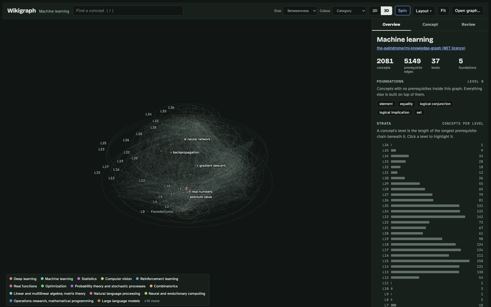

# Wikigraph

[](https://fellobello.github.io/wikigraph/)

**Live demo: https://fellobello.github.io/wikigraph/**

Build a prerequisite knowledge graph for any topic from Wikipedia. Then explore it as strata, with
foundations at the bottom, in the style of
[the-palindrome/ml-knowledge-graph](https://github.com/the-palindrome/ml-knowledge-graph).

The demo opens the machine-learning graph from that project (`sample-ml.json`) in 3D. Click any
concept to see its definition, prerequisites, dependents, a learning path and a link to Wikipedia.
[`ml.json`](ml.json) is a 413-concept graph this builder made from Wikipedia, starting at "Machine
learning". [Open it in the demo](https://fellobello.github.io/wikigraph/explorer.html?graph=ml.json).

## Quick start

Run these from the folder that holds `wikigraph.py`:

```
python3 wikigraph.py build "Machine learning" -o ml.json --contact you@example.com
python3 wikigraph.py review ml.json
python3 -m http.server
```

`review` lists what a human should check. The explorer has a 2D view and a 3D view (press 2 or 3).
In 3D, drag to rotate, shift-drag or right-drag to pan, and scroll to zoom. 3D loads three.js from
cdnjs, so it needs an internet connection. With the server running, open
http://localhost:8000/explorer.html and choose **Open graph…**.

The builder needs only Python 3.9+ and network access to `*.wikipedia.org`.

## Switch topics locally

`topic.py` builds a topic if it isn't built yet, then serves the folder and opens the explorer on it:

```
python3 topic.py "Cybernetics"
```

- Graphs are saved as `graphs/<slug>.json` (ignored by git). Running the same topic again opens it instantly.
- The explorer's **Topic** menu lists every topic you've built, so you can switch without the terminal.
  The menu only appears when the explorer runs locally.
- `python3 topic.py --list` lists built topics. `python3 topic.py` with no topic just opens the explorer.
- Each topic has its own curation file, `graphs/<slug>.curation.json`. Save the Review tab's output
  there, then run `python3 topic.py "Cybernetics" --rebuild`.
- Options after `--` go to the builder, for example `python3 topic.py "Cybernetics" --rebuild -- --max-nodes 600`.
- The Wikipedia User-Agent contact defaults to this repository's URL. Set `WIKIGRAPH_CONTACT` or
  `--contact` to use your own.

Any graph can also be opened by URL: `explorer.html?graph=ml.json`.

## How it stays finite

Following every link on Wikipedia never ends. Wikigraph reads only each article's **definition**,
the first lead paragraph outside parentheses, so every step points at something more basic. Filters,
a node budget and a set of "bedrock" concepts that are never expanded stop the crawl, and cycle
breaking plus transitive reduction keep the result a readable, layered graph.

| Problem | What the builder does |
| --- | --- |
| Endless expansion | It only follows links in a page's **definition**: the first lead paragraph, outside parentheses. These links point toward more basic ideas, so the crawl narrows toward foundations instead of spreading sideways. |
| Noise (people, places, years, journals, "List of…") | Filters on Wikipedia's short descriptions and titles. Every page it drops is logged in `review.filtered`. |
| Broad fields ("Statistics", "Mathematics") | Fields are not concepts. They are filtered out, and a topic that is itself a field or an outline page becomes a **hub**: its links become the seeds. |
| Budget | `--max-nodes` caps how many pages are expanded. A best-first queue expands the most-cited concepts first, so the budget cuts peripheral concepts. Unexpanded concepts cited by fewer than `--min-support` pages are dropped. |
| Bottomless regress | Terminal concepts (set, element, equality, logic connectives, natural number) are never expanded. Add your own with `--terminal` or in `curation.json`. |
| Cycles | Within each cycle, edges are kept from the more widely cited concept to the less cited one. Every dropped edge is listed for review. |
| Hairball | Transitive reduction: an edge A→C is dropped when A→B→C already exists. Metrics are computed before this step. |

Each node gets a level: the length of the longest prerequisite chain below it. Each node also gets
betweenness centrality, PageRank and the size of its prerequisite and dependent closures.

## Human in the loop

`curation.json` (see `curation.example.json`) can exclude, include, mark as terminal, add seeds,
merge, add or remove edges, and set categories. The **Review** tab in `explorer.html` writes this
file for you as you click. Rebuilds reuse `.wikigraph-cache/`, so repeated rounds are fast.

## Output

The output is `{meta, review, nodes}`. Nodes follow the palindrome format (`id`, `label`, `to`, `from`,
`category`, `definition`, `long_description`, `_betweenness_centrality`, …), plus `title`, `url` and
`_level`. Use `--array` to write a bare node list that the palindrome 3D explorer can load.

## Tests

`python3 -m unittest test_wikigraph test_topic` runs the full pipeline against a small fake Wikipedia
and checks the topic launcher.

## Credits

- Inspired by The Palindrome's "Map of Machine Learning" video, from the post
  [I Built the Knowledge Graph of Machine Learning](https://thepalindrome.org/p/i-built-the-knowledge-graph-of-machine),
  and its repository [the-palindrome/ml-knowledge-graph](https://github.com/the-palindrome/ml-knowledge-graph).
- `sample-ml.json` is derived from that repository's graph, MIT License, Copyright (c) 2026 Palindrome Labs.
  The full licence text is in [THIRD_PARTY_NOTICES.md](THIRD_PARTY_NOTICES.md).
- The 3D view uses [three.js](https://threejs.org) (MIT), loaded from cdnjs.
- Concept text and links come from [Wikipedia](https://en.wikipedia.org), available under CC BY-SA.

## Licence

Copyright (c) 2026 Steven Cochrane. All rights reserved. The code in this repository is published
for viewing; no licence is granted to reuse it. Third-party material keeps its own licence (see
[THIRD_PARTY_NOTICES.md](THIRD_PARTY_NOTICES.md)).
